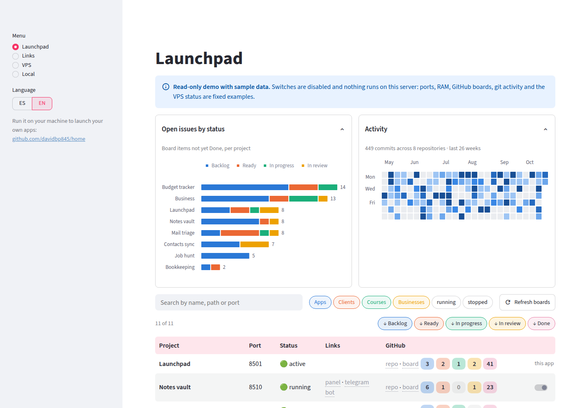
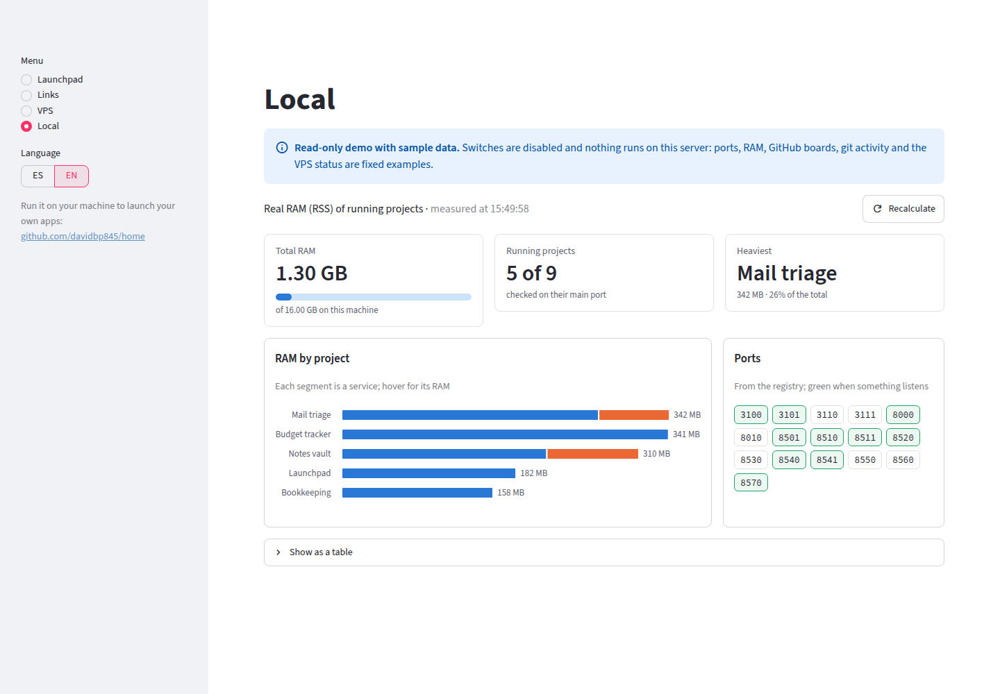
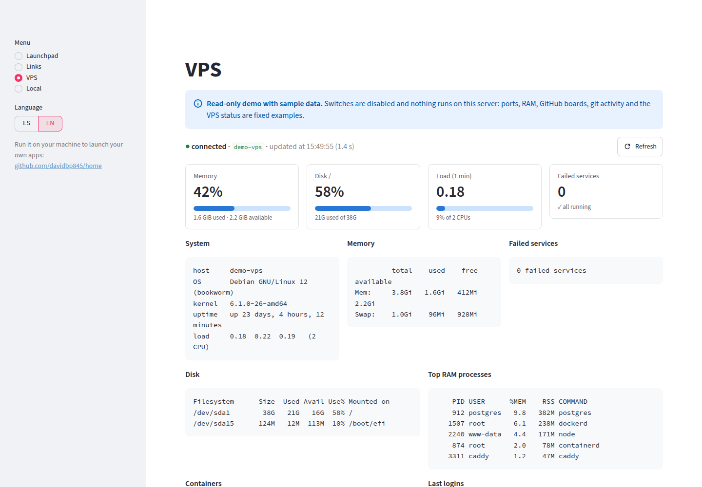

# Launchpad

A local launcher for the Streamlit apps (and anything else that listens on a port) you keep on your machine. One page to see what is running, start and stop each project with its own script, open its services, and get a glance at its GitHub board, your git activity and how much RAM everything uses.


*The read-only demo, with sample data. Run it yourself in two commands: [Try the demo](#try-the-demo).*

## What it does (and what it doesn't)

| Does | Doesn't |
|---|---|
| Start and stop each project with its own script or systemd service | Rebuild other projects' start commands |
| Tell whether something is running by its port, whoever started it | Supervise or restart what crashes |
| Wait until every service of a project answers before turning green | Store or show logs |
| Show each project's GitHub repo and board, with issues per status | Edit projects or links from the panel |
| Chart open issues per status, git activity (26-week heatmap) and RAM per project and service | Keep any history |
| Searchable links table with colored tags | |
| Read-only status of a VPS over SSH (memory, disk, load, failed services, containers) | Watch the VPS or act on it |
| English and Spanish interface | Give remote access to the real launcher |

## Pages

- **Launchpad**: two collapsible charts (open issues per status, commit activity), then one row per project with its port, status, links, GitHub repo and board counts, and an on/off switch. Search by name, path or port; filter by folder and status; sort by issues in a board column.
- **Links**: your bookmarks as a searchable table with tag filters.
- **VPS**: memory, disk, load and failed-services meters over the raw output of a fixed, read-only script sent over SSH.
- **Local**: total RAM, running projects, the heaviest one, RAM per project split by service, and which registry ports are listening.



| Local | VPS |
|---|---|
|  |  |

## Try the demo

```bash
python3 -m venv venv && ./venv/bin/pip install -r requirements.txt
HOME_LAUNCHER_DEMO=1 ./venv/bin/streamlit run app.py
```

With `HOME_LAUNCHER_DEMO=1` the app reads the sample data in [`demo/`](demo) and runs nothing on your system: no ports, `ps`/`ss`, `gh`, `git` or SSH. Switches are disabled and links to `localhost` are plain text.

## Use it with your own projects

The launcher keeps no data in the repo. It reads three files from a data folder: `../datos` next to the repo by default, or `HOME_LAUNCHER_DATOS`.

**`proyectos.toml`**, the project registry ([full format, in Spanish](doc/A1-Vision/3-modelo-de-datos.md)). Each project knows how to start itself; the launcher only calls its script:

```toml
[[proyecto]]
nombre = "Notes vault"       # shown name
slug = "notes"               # stable id
puerto = 8510                # main port: decides running / stopped
ruta = "Apps/notes-vault"    # folder, relative to HOME_LAUNCHER_RAIZ
cmd = ["./start.sh"]         # start command, run from that folder
# cmd_detener = ["./stop.sh"]  optional; otherwise SIGTERM to whoever listens on the port
enlaces = [                  # optional: one link per service, and the switch waits for all of them
  { etiqueta = "panel", puerto = 8510 },
  { etiqueta = "telegram bot", puerto = 8511, ruta_url = "/health" },
]
```

A project without `cmd` is the launcher itself. The `[negocios]` section (a group of multi-tenant "business" rows driven by another project's `dev_up.sh`) is specific to the author's setup and optional: without it there are no business rows and no **Negocios** filter. [`demo/proyectos.toml`](demo/proyectos.toml) has a minimal one.

**`enlaces.csv`**: `descripcion,enlace,etiquetas`, with several tags separated by `;`.

**`vps.toml`**: `[[vps]]` entries with `nombre` and `host`, an alias from `~/.ssh/config`. Credentials never go in the file. What runs on the server is always [`scripts/estado_vps.sh`](scripts/estado_vps.sh), read-only.

**GitHub boards** are optional. A project gets its repo link from its git `origin` (or its first submodule's) and its board from a line like ``- Tablero: project "Home" (owner `me`, número `9`)`` in the nearest `CLAUDE.md` with a `## Método` section. Board counts need `gh` logged in.

| Variable | Meaning |
|---|---|
| `HOME_LAUNCHER_DATOS` | Data folder (default `../datos`; `demo/` in demo mode) |
| `HOME_LAUNCHER_RAIZ` | Folder the registry paths are relative to (default: three levels above the repo) |
| `HOME_LAUNCHER_DEMO` | `1` for the read-only demo |
| `HOME_LAUNCHER_IDIOMA` | Initial language, `es` or `en` (default `es`; `en` in demo mode); switch it in the sidebar |

Run it with `./start.sh` (port 8501, localhost only, set in `.streamlit/config.toml`). It has no authentication: never expose it to a network. For daily use there is a systemd user service in [`deploy/`](deploy).

## Development

```bash
./venv/bin/pip install -r requirements.txt -r requirements-dev.txt
./venv/bin/pytest
./venv/bin/ruff check . && ./venv/bin/ruff format --check .
```

Tests use only `tests/fixtures/` and `demo/`. None of them starts processes, opens SSH connections or needs real data, and the demo tests fail if anything calls `subprocess` or opens a socket.

```
app.py              # Streamlit pages and process control
textos.py           # visible texts in Spanish and English
graficos.py         # Altair charts and stat tiles
actividad.py        # commits per day across the registry's repos (git log)
demo.py             # sample data used instead of querying the system in demo mode
demo/               # sample registry, links, VPS and state for the demo
config/             # paths, demo mode, language, and the registry / VPS loaders
vps.py              # SSH query to the VPS, sections and meters
ram.py              # real RAM (RSS) of each running project
github.py           # each project's repo and board, and board counts with gh
scripts/            # estado_vps.sh, the read-only script sent to the VPS
tests/              # pytest and AppTest, with fictitious fixtures
deploy/             # systemd user service
doc/                # design docs (in Spanish): vision, ADRs, mockups
```

Code identifiers and the design docs in [`doc/`](doc) are in Spanish. The decisions behind the launcher are in [`doc/A2-ADR/`](doc/A2-ADR/README.md); the read-only demo is [ADR-0010](doc/A2-ADR/0010-demo-publica-de-solo-lectura.md).

## License

[MIT](LICENSE), see [ADR-0011](doc/A2-ADR/0011-licencia-mit.md). "Lanzadera" is the author's name for this launcher; customization, installation, training and support are offered by the author.
